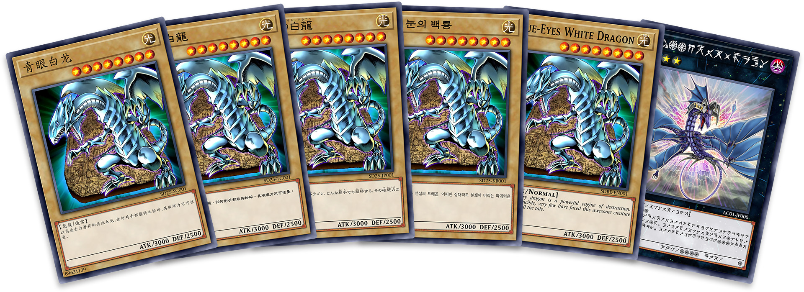

<h1 align="center">🎉 Yu-Gi-Oh! Card - Yugioh Card 🎉</h1>

  
<a href="./README.md">简体中文</a> | English

  
  
  

Render Yu-Gi-Oh! cards on Canvas with LeaferJS

  

Currently there are 5 types of cards: 🚀🚀🚀🚀🚀

- 1️⃣ Yu-Gi-Oh!
- 2️⃣ Rush Duel
- 3️⃣ Yu-Gi-Oh! Card Back
- 4️⃣ Field Center Card
- 5️⃣ Yu-Gi-Oh! Series 2

## 🫡 Special Thanks

- [LeaferJS](https://www.leaferjs.com/) for the powerful graphics rendering capabilities
- [白羽幸鳥](https://tieba.baidu.com/home/main?id=tb.1.d6c63ffd.3YV5T6Q9Z7uIeVVhPlo8hg%3Ft%3D1654573649) for providing high-resolution card templates

## 🚩 Documentation and Demo

[Documentation](https://kooriookami.github.io/yugioh-card/en/) · [Playground](https://kooriookami.github.io/yugioh-card/en/playground/)
