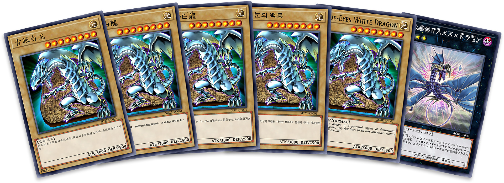

<h1 align="center">🎉 游戏王卡片 - Yugioh Card 🎉</h1>

  
简体中文 | <a href="./README.en.md">English</a>

  
  
  

一个基于 LeaferJS、使用 Canvas 渲染游戏王卡片的工具

  

目前有 5 种卡片：🚀🚀🚀🚀🚀

- 1️⃣ 游戏王
- 2️⃣ 超速决斗
- 3️⃣ 游戏王卡背
- 4️⃣ 场地中心卡
- 5️⃣ 游戏王 2 期

## 🫡 特别感谢

- [LeaferJS](https://www.leaferjs.com/) 提供的强大图形渲染功能
- [白羽幸鳥](https://tieba.baidu.com/home/main?id=tb.1.d6c63ffd.3YV5T6Q9Z7uIeVVhPlo8hg%3Ft%3D1654573649) 提供的高清卡模

## 🚩 文档与在线演示

[项目文档](https://kooriookami.github.io/yugioh-card/) · [在线演示](https://kooriookami.github.io/yugioh-card/playground/)

克隆仓库并运行 `pnpm install` 后，可用 `pnpm test:pages` 在本地打开浏览器测试和预览页面。
