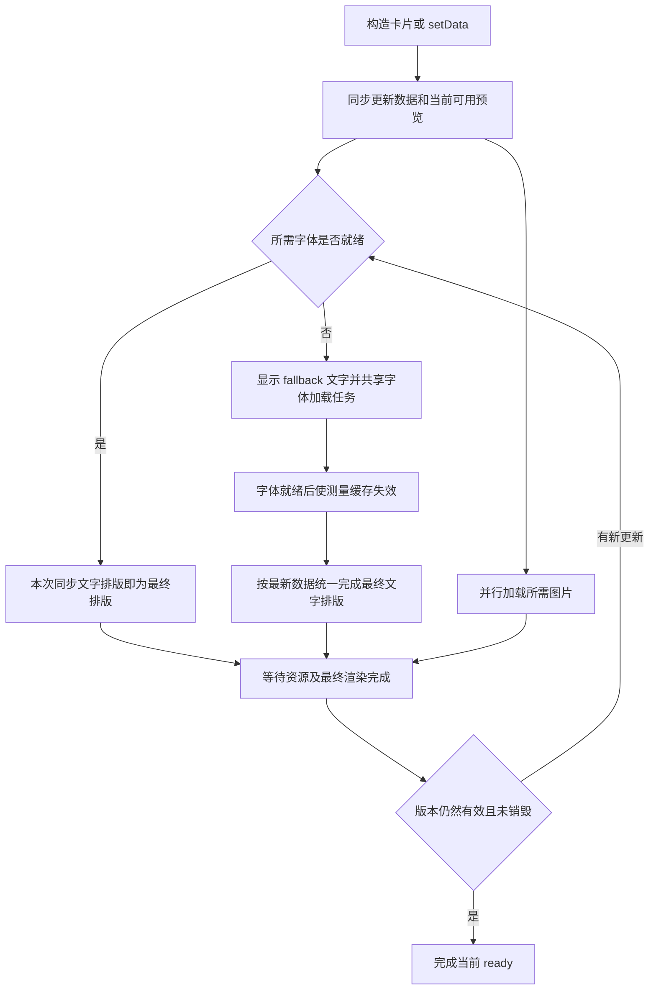

# 统一资源加载与卡片就绪接口设计

- 状态：v0.2，已在 `codex/unified-card-ready` 实现，待合并。
- 日期：2026-11-14。
- 背景：[PR #28](https://github.com/kooriookami/yugioh-card/pull/28)、[需求与流程草案](https://github.com/kooriookami/yugioh-card/pull/28#issuecomment-6875407317)。
- 适用范围：浏览器与 Node.js，以及当前全部五种卡片。
- 实现归属：由项目维护方继续设计和开发，不要求 PR #28 的贡献者继续实现。

## 1. 设计目标与范围

卡片应尽早展示可用预览，同时让调用方能够明确等待字体、图片、最终排版和绘制完成，再导出图片或读取最终尺寸。

已确认的需求：

1. 浏览器字体尚未加载时，保留 fallback 字体预览，避免首屏文字空白。
2. 真实字体加载完成后，统一重新测量、排版和绘制，减少重复重排。
3. 浏览器和 Node.js 共用 `card.ready` 的完成语义，平台差异留在加载适配层。
4. 资源已经就绪时，普通 `setData()` 调用继续同步更新绘图节点。
5. 复用浏览器字体 API、现有加载函数和 Leafer 的资源及渲染机制。

本稿提出的 API 返回类型、更新期间的 Promise 行为、失败策略与多卡等待范围属于推荐方案，仍需在实现前确认。第 12 节列出待决事项。

本次不涉及卡片数据结构、排版算法、固定布局高度、PR #27 的重命名，也不引入新的 Canvas 引擎。第一版不增加导出快照、资源进度条或通用任务管理框架。

## 2. 实现前的流程及问题

以下记录实现前的流程（基于 master `82ea698`），用于说明本次调整的原因：

| 位置 | 当前职责 |
| --- | --- |
| [Card 基类](../packages/src/card/index.js) | 启动字体加载；`setData()` 立即调用 `draw()`；字体加载结束后再次调用 `draw()` |
| [字体工具](../packages/src/utils/index.js) | 浏览器获取字体列表、创建 `FontFace` 并等待加载；Node 同步注册字体 |
| [CompressText](../packages/src/compress-text/compress-text.js) | 初始化、参数变化时排版；浏览器中还会等待 `document.fonts.ready`，再延迟 250ms 重排 |
| [演示组件](../src/components/YugiohCard.vue) | 更新数据、切换卡片并调用 Leafer 导出 |

浏览器中的实际顺序是：

```text
发起字体请求
  → 立即按当前可用字体生成预览
  → 字体请求完成后 Card 再次 draw
  → 各 CompressText 还可能独立执行延迟重排
```

首次 fallback 排版有即时预览的价值，应保留。需要处理的是后续调度：

- 字体列表通过 `fetch` 获取，列表返回前字体尚未注册，之前读取的 `document.fonts.ready` 可能已经完成。
- 当前路径缓存把“开始加载”当成“已经加载”，相同路径的第二个调用方可能提前完成等待。
- `CompressText.set()` 会跳过参数未变化的更新；字体文件可用后，即使文本参数相同，也必须使原有测量结果失效。
- Card 和文字组件各自等待、各自重排，缺少统一的最终完成边界。
- 固定的 250ms 延迟不能证明字体已加载或画面已更新。
- Node 字体同步注册，并不意味着图片加载和最终绘制也同步完成。

## 3. 对外接口

`Card` 基类提供只读属性，由所有卡片类继承：

```ts
readonly ready: Promise<void>;
```

保持现有 `setData()` 的调用方式和返回行为，不把它改成必须等待的异步方法：

```js
const card = new YugiohCard(options);

await card.ready;
const result = await card.leafer.export('png', { screenshot: true });

card.setData({ name: '新的卡名' });
await card.ready;
// 此后读取该次更新的最终文字边界，或再次导出。
```

配置方式沿用 [README](../README.md)，本文件中的示例描述拟议行为，不代表当前版本已经支持。

### 3.1 完成条件

`ready` 成功完成前，必须同时满足：

1. 当前数据所需的项目字体已成功加载、注册并可用于测量。
2. 当前数据所需的卡框、卡图、属性、标记等图片已成功加载。
3. 文字测量使用最终字体，压缩、注音、对齐及依赖文字边界的位置已经更新。
4. 上述结果已经完成 Leafer 的布局和渲染，不只是执行完 `draw()`。
5. 检查期间没有更新的数据版本使上述结果过期，卡片也没有被销毁。

“当前所需”指当前卡片实际使用的资源。空图片地址、未启用的可选效果不构成加载任务；字体目录中的未使用字体可以预加载，但不应被误当成本卡必需资源。第一版若仍按字体目录整体加载，应明确其等待范围与性能影响。

成功就绪不表示动画永久停止，也不保证未来的 `setData()` 已经完成。调用方自行修改 `card.leafer` 或子节点、启动未登记的异步任务，不在该接口的自动跟踪范围内。

### 3.2 数据更新与 Promise 身份

建议将一个尚未完成的 Promise 表示为“下一次稳定完成”，内部用递增的 `revision` 区分更新：

| 情况 | 推荐行为 |
| --- | --- |
| 首次构造 | 即建立待完成的 `ready`，不使用 `null` 表示初始化中 |
| 等待期间再次 `setData()` | 更新 `revision` 和最新数据，复用尚未完成的 Promise，最终按最新数据完成 |
| 前一个 Promise 已完成或失败后再次 `setData()` | 创建新的 Promise，即使资源已缓存，也要等待本次最终渲染 |
| 旧字体、图片或渲染回调到达 | 检查当前依赖和版本，不能覆盖新结果或错误地完成 `ready` |
| 读取 `ready`，但没有新更新 | 返回同一个 Promise，不因读取属性启动任务 |

例如，在字体加载期间连续提交 A、B、C 三份数据，等待者在 C 的最终画面完成后统一继续，不承诺中间的 A、B 各自完成一次最终排版。

已经完成的 Promise 不会因为未来更新重新变为 pending。每次 `setData()` 后，调用方应重新读取 `card.ready`，不能长期保存第一次的 Promise 用于所有更新。

`ready` 是完成通知，不是数据锁。若等待完成后还有其他代码修改同一卡片，导出结果可能包含后续更新；要求固定数据快照的调用方，应在操作期间停止更新或使用独立卡片实例。导出快照接口另行设计。

## 4. 预览与最终排版流程



`setData()` 仍同步写入数据并更新当前可用预览。字体未就绪时，这次预览可能使用 fallback；用户编辑时的预览不应因为等待资源而被冻结。

合并的是“资源完成后的最终校正”和等待回调，不是取消用户明确发起的所有预览更新。资源已缓存时，不应为了经过同一个 Promise 链，再完整排版第二遍；Leafer 自身仍可按帧合并绘制。

这里的“一次排版”指一次完整的文字排版流程，不限制压缩算法内部为了收敛而进行的多轮试排。

## 5. 共享层与平台适配

建议将共享的完成判断放在 Card 的内部协调器中，平台加载器只提供资源记录：

| 层次 | 职责 |
| --- | --- |
| Card | 接收数据，保持同步预览，提供 `ready`，调用卡片自身的绘制方法 |
| 内部就绪协调器 | 管理当前版本、当前依赖、最终文字排版及渲染等待，完成或拒绝 Promise |
| 字体加载适配器 | 获取清单、注册和加载字体，返回缓存状态、共享 Promise 与错误 |
| Leafer 适配器 | 观察图片加载及错误，等待最终布局、绘制，并对接销毁生命周期 |

Card 基类可以先建立协调器并启动加载，但不能在子类初始化完成前调用 `draw()`。子类的成员初始化、`initLeafer()` 和首次 `setData()` 完成接入后，才能走绘制及就绪检查；字体缓存命中也必须遵守这一顺序。

### 5.1 字体加载

- 浏览器复用 `FontFace.load()` 的 Promise；`document.fonts.ready`、`loadingdone` 用于补充通知，不能替代获取字体列表这一阶段的等待。
- Node 继续同步调用字体注册函数。成功结果提供已完成的 Promise 参与统一协调，不把原有同步加载人为延迟到微任务。
- 缓存记录至少区分 `loading`、`loaded`、`failed`；路径存在于缓存中，不等于加载成功。
- 同一资源的并发调用共享真实加载 Promise。失败记录不能永久阻止重试，也不能触发无限自动重试。
- 缓存键需包含规范化资源路径和字体标识；Node 还应考虑字体库作用域，避免跨字体库误用已注册状态。
- 无文字的卡背、场地中心卡不需要等待不存在的字体任务。
- `Promise.allSettled()` 可以用于收集错误，但不能吞掉必需字体的失败，再把 `ready` 标记为成功。

识别字体需求时，应覆盖样式中的字体、注音字体，以及数字、卡包编号等绘制方法内直接指定的字体，不能只按 `data.language` 判断。复用现有清单与实际绘图配置，避免维护一份容易与绘制代码脱节的语言映射。

第一版可以保留现有按卡片家族加载字体清单的方式；按语言、样式进一步按需加载应独立评估，避免在同一次改动中重写字体分配规则。

### 5.2 图片加载

继续使用 Leafer 的图片资源与缓存。协调器需要能够知道当前卡片所需图片的加载结果，而不只是知道队列已结束。

当前 `listenImageStatus()` 主要服务卡图占位提示，并不能直接证明所有卡框、属性和效果图片成功加载。实现时须验证 Image、Rect 的图片填充及其他当前使用的图片路径，统一覆盖成功和失败通知。

卡图地址改变后，旧地址的完成或失败事件只能更新旧记录，不能改变新卡图的状态。旧任务可以继续供其他使用者共享，但不得再影响本卡的完成判断。

## 6. 复用 Leafer 时的边界

本稿核对了项目安装的 Leafer 2.3.4：

- `waitReady()` 对应首次布局完成，不等于字体和图片就绪。
- `waitViewCompleted()` 等待图片资源及视图完成。
- `export()` 内部已经调用视图完成等待，并检查 `Resource.isComplete`。
- `Resource.tasker` 支持登记自定义异步资源任务，导出会等待这些任务。

建议复用这些能力，不在项目里重新实现图片加载器、Canvas 渲染循环或独立的全局资源队列。需要让现有直接调用 `card.leafer.export()` 的路径也等待项目字体时，可以登记字体加载任务；登记必须早于可能发生的导出。

### 6.1 防止等待环

登记到 `Resource.tasker` 的任务只能覆盖资源加载阶段。不能登记整个 `card.ready`，也不能在该任务内部等待 `waitViewCompleted()`：

```text
全局资源任务等待视图完成
  → 视图完成又等待全局资源任务结束
  → 当前资源任务无法结束
```

字体加载、最终重排和视图等待应按顺序衔接，视图等待必须位于资源任务之外。资源任务中的异常要同时传递给本卡协调器，不能只依赖 Leafer 的任务队列完成标志。

### 6.2 多卡实例的全局影响

Leafer 2.3.4 的 `imageReady` 实际依赖 `viewReady && Resource.isComplete`，其中 `Resource` 是同一运行时中的全局对象。因此直接复用 `waitViewCompleted()`，可能让卡片 A 等待卡片 B 的资源。

第一版建议先复用现有等待机制，并明确这一限制；不能宣称已经实现多卡互不等待。单卡协调器仍只接受自身当前版本的结果，其他卡片失败也不能直接变成本卡的资源失败。

若要求严格的实例隔离，应另行验证“当前卡片资源全部结束后，再等待该实例下一次完整渲染”的适配方式。不能仅换用一次 `RenderEvent.END` 就省略图片加载确认。多卡等待范围是实现前必须确认的技术边界。

## 7. 字体就绪后的测量失效

最终字体可用后，不能只依赖 `draw()` 再传一遍相同参数：当前 `CompressText.set()` 会跳过值未变化的配置。

建议增加内部的字体测量失效标记，由协调器统一处理：

1. 标记受影响的文字测量结果过期，即使文本、字号、宽高没有改变。
2. 在一次更新中使用最终字体重新测量并完成文字布局；失效标记只做标记，不先单独完整排版一遍。
3. 同时更新普通 Leafer Text 和 `CompressText`，覆盖攻击力、防御力等未使用 `CompressText` 的文字。
4. 在文字边界更新后，重新计算卡名对齐、卡包编号位置、魔陷名称组合等依赖边界的布局。
5. 完成上述过程后，再进入最终渲染等待。

卡片管理的文字组件不再各自注册同一批字体任务的完成重排，也不使用 250ms 延迟猜测完成时间。

独立使用 `CompressText` 的场景仍需支持字体变化后的重排。实现时应保留其独立通知入口，或提供内部注入机制，区分由 Card 统一管理和独立使用两种情况，避免重复订阅或漏掉重排。底层文字缓存应通过已验证的公开失效能力更新，不直接修改 Leafer 私有字段。

## 8. 更新、失败与销毁

### 8.1 更新期间的一致性

每次 `setData()` 都应在修改绘图节点前推进内部 `revision`。异步回调完成时，检查资源是否仍被当前版本使用。

协调器只为当前状态安排一次有效的最终检查；存在尚未执行的渲染回调时，更新数据使它过期，而不是不断追加捕获旧数据的回调。字体加载完成后使用最新数据，不保存一份构造时的数据再覆盖用户编辑。

最终排版可能产生新的图片依赖。完成检查应重新确认当前依赖和版本；新增依赖尚未结束时继续等待，不提前完成 Promise。持续更新期间，`ready` 可以持续 pending，直到当前画面稳定。

### 8.2 推荐失败策略

本稿建议第一版采用严格的成功语义：预览可以使用 fallback 或错误占位图，但必需资源失败时，`ready` 拒绝，调用方决定是否仍导出该预览。

| 情况 | 推荐行为 |
| --- | --- |
| 字体清单或必需字体失败 | 保留可用预览，记录具体失败并拒绝当前等待 |
| 必需图片失败 | 保留现有占位提示，拒绝当前等待；队列结束不代表资源成功 |
| 未使用的预加载资源失败 | 不作为本卡失败；全局等待可能造成的延迟另行处理 |
| 空地址、未启用的可选效果 | 不建立必需加载任务 |
| 最终排版或渲染错误 | 拒绝等待，保留错误阶段与原因 |
| 加载或视图等待超时 | 拒绝等待；构造参数 `readyTimeout` 设置每轮超时，默认 30000ms，必须为正有限数 |
| 失败后用户发起新更新 | 建立新的等待周期，允许重新请求失败资源；不能无限自动重试 |

同步构造或同步 `setData()` 原有的抛错行为不应被静默改为异步报错。新的 `ready` 不得导致原先不读取它的使用者产生未处理的 Promise rejection；实现时可给内部保存的 Promise 附加处理器，但对外必须仍返回原 Promise，保留调用方 `await` 时的拒绝行为。

首次构造的同步绘制或资源登记失败时，先用原始异常拒绝 `ready`，再释放本卡的订阅、图片引用和 Leafer；此时调用方拿不到实例，无法自行清理。后续 `setData()` 绘制失败则保留实例和已有资源，允许修正数据后重试。

“允许使用后备字体后仍成功完成，并通过结果返回警告”也可作为候选方案，但与严格语义不同，须明确选择，不能一边报告成功、一边要求调用方猜测资源是否缺失。

### 8.3 销毁

兼容现有 `card.leafer.destroy()` 和 `destroy(true)` 调用方式。当前 Leafer 销毁过程会发出 `LeaferEvent.END`，可作为适配入口，具体执行顺序需要两端验证。

销毁开始后，协调器标记失效、解绑监听并拒绝尚未结束的等待。迟到的字体、图片和渲染回调不能重建文字节点、再次绘制或错误完成 `ready`。

销毁单个卡片不能清空全局字体缓存、调用全局 `Resource.destroy()`，也不能中止其他卡片仍然使用的共享任务。已完成的 Promise 保持完成状态；销毁后的新更新应明确报错。

## 9. 兼容性与接入

- 保留同步构造对象、同步更新数据和可用预览的行为。资源未就绪时，立即读取的边界属于预览结果；要求最终边界的使用者需等待 `ready`。
- 已缓存字体的普通更新不额外进入异步文字排版路径；图片和引擎绘制仍可以异步完成。
- 不为卡背、场地中心卡增加无关字体等待；Node 不能仅因字体同步加载就立即完成 `ready`。
- `card.leafer.export()` 的现有入口保持可用。项目示例逐步增加 `await card.ready`，先明确本卡资源与排版成功，再交给引擎导出。
- `ready` 不保证导出编码成功；跨域画布限制、文件写入失败等仍由 `export()` 的结果或错误处理。
- Node 服务示例应处理等待与导出失败，并在请求结束后释放卡片；错误响应格式沿用服务自身约定。
- 中英文 README、示例和生成的类型声明已同步提供 `ready` 与 `readyTimeout` 的使用方式。

## 10. 建议实现步骤

1. **验证引擎边界。** 在浏览器和 Node 验证图片成功、失败、视图完成、全局资源影响及销毁事件顺序，确认第 6 节的接入方式。
2. **整理资源记录。** 修复字体缓存的并发等待和失败重试；保留同步 Node 字体加载，收集必需资源的成功、失败结果。
3. **增加内部协调器。** 实现 Promise 周期、更新版本检查和两端一致的 `ready` 完成条件。可新增 `packages/src/card/readiness.js`，保持内部使用。
4. **统一最终文字重排。** 引入测量失效标记，更新依赖文字边界的位置，处理普通 Text 与独立 `CompressText`，移除重复等待及固定延时。
5. **接入示例和声明。** 更新浏览器、Node 示例及中英文文档。若新增公开辅助函数或类型，同步维护 `packages/index.js`；内部协调器不单独公开。
6. **验证并发布。** 完成下表中的行为测试、构建和兼容性检查后，再决定发布说明与版本。

资源修复、统一接口和排版调度可以分步提交，但每一步应具有完整的失败清理与回归验证，不发布仅等待字体就宣称整卡就绪的过渡 API。

## 11. 验证与验收

| 场景 | 验收结果 |
| --- | --- |
| 浏览器冷缓存、字体请求延迟 | fallback 预览可见；`ready` 在最终字体排版和渲染完成前不成功 |
| 字体清单尚未返回 | 提前完成的 `document.fonts.ready` 不导致本卡提前就绪 |
| 同一路径并发创建卡片 | 共享实际加载任务，第二个实例不会被当成缓存已完成 |
| 字体加载完成，文本参数未变化 | 真实字体测量生效，文字边界及依赖位置正确 |
| 字体已缓存 | 普通 `setData()` 保持同步节点更新，不额外完整重排一次 |
| 等待期间连续更新 | 最终结果使用最新数据，旧回调不能完成新状态或覆盖新图 |
| 切换语言、字体或卡片家族 | 新依赖进入等待；不继续使用旧字体的最终测量结果 |
| 文字已完成、图片仍在加载 | `ready` 继续等待 |
| 图片地址由 A 改为 B | A 的迟到结果不影响 B；B 就绪并绘制后才完成 |
| 必需字体、图片失败及重试 | 严格失败语义可观察、预览保留、新周期可恢复 |
| Node 字体同步、图片异步 | 对外语义与浏览器一致，不能跳过图片和渲染等待 |
| 五种内置卡片 | 均支持 `ready`，无字体卡片不等待字体 |
| 多卡及全局资源任务 | 验证并记录全局等待影响，不误报实例隔离或其他卡片的错误 |
| 资源任务与视图等待 | 不存在第 6.1 节的循环等待 |
| 资源或视图等待超时 | 等待能失败结束，不永久 pending |
| 等待期间销毁 | Promise 按约定结束，无重建、重绘或监听泄漏 |
| 使用者不读取 `ready` | 失败或销毁不产生未处理 rejection |
| 独立使用 CompressText | 字体变化仍可正确重排，Card 管理时不重复触发 |
| 等待完成后再次更新 | 新 Promise 等待新画面，旧 Promise 不被误当成持续就绪状态 |

资源时序测试应使用可控制的加载完成和失败信号，不用固定 sleep 代替断言。至少保留真实字体、真实文字测量与图片资源的集成用例，不能只模拟 `set()` 接收参数。

使用现有 Node 原生测试体系验证共享逻辑和 Node 渲染，浏览器侧验证真实 FontFace 与 Leafer 行为。统计有效文字块的完整重排次数，并区分用户更新、fallback 预览、真实字体校正和算法内部试排。

实现时执行 `pnpm test`、相关文件 ESLint、`pnpm build:lib`；修改演示应用后执行 `pnpm build`。文档本身只需检查内容、格式和链接。

## 12. 本次实现的决策与落点

采用第 3.2 节的 Promise 周期、严格拒绝的成功语义，以及 Leafer 全局资源队列的已知限制。`readyTimeout` 默认 30 秒；字体清单及单个 FontFace 加载也有 30 秒的资源超时，避免共享字体任务永久占用全局队列。全局其他任务过慢仍可能使本卡等待超时，本次不承诺实例级资源隔离。

资源失败提供 `CardReadyError` 的 `code: 'RESOURCE_FAILED'`，并附带 `resourceType`、`resource`、`cause`；整卡等待超时使用 `READY_TIMEOUT`，销毁使用 `CARD_DESTROYED`。字体资源超时记录在资源错误的 `cause.code: 'RESOURCE_TIMEOUT'`。同步 Node 字体注册和同步绘制的原有异常继续同步抛出。

每轮检查先扫描当前依赖的已知失败，再决定是否继续等待；仍在加载的字体清单、字体或其他图片不能遮蔽已经失败的必需图片。演示页在切换卡片或卸载组件后忽略旧导出任务的结果与错误，当前实例的实际加载、导出错误仍正常提示。

| 实现位置 | 职责 |
| --- | --- |
| [字体适配](../packages/src/utils/font-loader.js) | 按 FontFaceSet / FontLibrary 缓存实际资源记录，区分清单与字体完成状态，复用进行中的任务并允许新周期重试 |
| [就绪协调器](../packages/src/card/readiness.js) | 合并 pending 更新，按当前字体依赖统一重排，等待本卡图片和新一帧渲染，并处理超时、失败和销毁 |
| [图片适配](../packages/src/card/resources.js) | 收集可见节点的图片填充与描边，复用 ImageManager，清理自己的引用与回调，忽略失效地址 |
| [文字上下文](../packages/src/compress-text/layout-context.js) | 将字体测量版本传给内置 CompressText，相同参数也能重测量；保留独立组件的字体通知 |

字体加载后的普通 Text 会一并标记测量失效，包括暂时隐藏的节点，防止后续显示时保留 fallback 测量。图片状态图不属于必需资源；移除卡图或重试成功后清理其状态显示。测试同时发现 Rush Duel 注音曾继承 `ygo-tip`，现明确使用该卡片资源包内的 `rd-tip`。

自动回归测试位于 [卡片测试](../packages/src/card/__tests__/) 与 [字体测试](../packages/src/utils/__tests__/)；保留真实 Skia 字体测量、五种卡片 PNG 导出，以及可控的异步加载、失败和销毁用例。运行 `pnpm test`。

浏览器验证入口为 [受控资源服务](../packages/src/card/__tests__/browser/server.mjs)。在仓库根目录运行 `node packages/src/card/__tests__/browser/server.mjs`，使用外部 Edge 打开 `http://127.0.0.1:5175/ready-fixture`，先检查 fallback 预览，再点击“释放资源并验证”。该页面使用真实 FontFace 和 Leafer，控制字体清单、字体与图片的返回时机，并校验缓存、重排、失败重试、独立 CompressText、销毁及最终 PNG 导出。

同一服务的 `http://127.0.0.1:5175/export-fixture` 挂载真实演示组件并延迟字体清单；先点“导出图片”，再切换卡片或点“卸载组件”，累计错误提示应保持为零。导出处理函数的自动回归位于 [组件测试](../src/components/__tests__/export-image.test.js)，同时覆盖当前卡片的真实错误提示。

## 13. 参考资料

- [项目使用方式与 Data 属性](../README.md)
- [CSS Font Loading API](https://developer.mozilla.org/en-US/docs/Web/API/CSS_Font_Loading_API)
- [FontFaceSet.ready](https://developer.mozilla.org/en-US/docs/Web/API/FontFaceSet/ready)
- [Leafer 状态与等待方法](https://www.leaferjs.com/ui/reference/display/Leafer.html)
- [Leafer Resource 与自定义异步任务](https://www.leaferjs.com/ui/reference/resource/Resource.html)
- [Leafer 导出接口](https://www.leaferjs.com/ui/reference/UI/export.html)

引擎行为以当前安装的 2.3.4 源码核对；升级依赖后，应重新验证全局任务、完成回调和销毁顺序。
